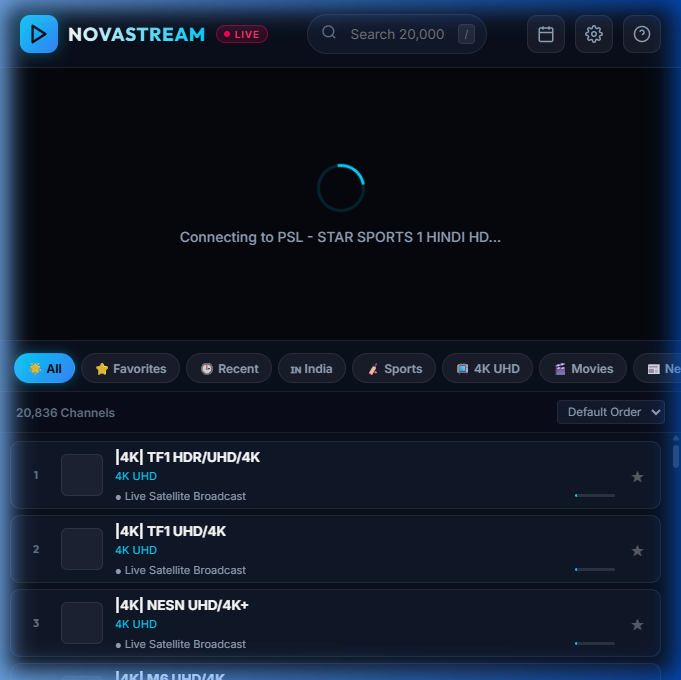

# 🎬 NovaStream IPTV — Premium Live TV & EPG Cinema Player

[](https://www.python.org/)
[](LICENSE)
[](https://github.com/video-dev/hls.js)
[](#)

NovaStream IPTV is a professional, high-performance web-based IPTV player and live streaming proxy inspired by **TiviMate** and **OTT Navigator**. It bypasses CORS, rewrites HLS manifests on the fly, defeats upstream rate-limiting (`429 Too Many Requests`), and streams over **20,000+ live TV channels** with zero buffer bloat.

---

## 📺 Interface Preview



---

## ✨ Features

- **⚡ Real-Time Streaming Proxy & CORS Bypass**:
  - Built-in multi-threaded proxy server in Python.
  - Dynamically rewrites `.m3u8` playlists and proxies `.ts` transport stream chunks.
  - Automatically spoofs authentic TV player headers (`TiviMate/4.7.0` + custom Referers) to prevent upstream blocking.
- **🎨 TiviMate & Cinema OLED Interface**:
  - Deep OLED black background with ambient backlight reflection.
  - Glassmorphic translucent panels with micro-animations.
  - Live On-Screen Display (OSD) showing channel logo, number, genre, and show progress.
- **🔊 Web Audio API Volume Booster**:
  - Boost audio output by **+200%** with a single click for low-gain satellite feeds.
- **🕒 Intelligent Dynamic EPG (Program Guide)**:
  - Generates real-time broadcast schedules, currently airing programs, and timeline progress bars.
  - Pop-up full-screen EPG schedule modal.
- **📺 Aspect Ratio Switching**:
  - Cycle between `16:9`, `4:3`, `Fill`, and `Stretch` on the fly without refreshing.
- **🔍 Instant Channel Search & Filters**:
  - Filter across 350+ categories (`India`, `Sports`, `4K UHD`, `Movies`, `News`, etc.).
  - Instant fuzzy search by channel name or category.
  - One-tap Favorites (★) saved to local storage.
- **📱 Smart TV & Mobile LAN Streaming**:
  - Access from any device on your Wi-Fi network (Android TV, LG webOS, Samsung Tizen, iPhone, iPad, Android).
- **🚀 One-Click Windows Launcher**:
  - Double-click `start_iptv.bat` to boot the proxy and open your browser automatically.

---

## 🚀 Quick Start Guide

### Prerequisites
- [Python 3.8+](https://www.python.org/downloads/) installed. *(No external pip dependencies needed; uses Python standard library!)*

### Running Locally

1. **Clone the repository**:
   ```bash
   git clone https://github.com/YOUR_USERNAME/NovaStream-IPTV.git
   cd NovaStream-IPTV
   ```

2. **Start the player**:
   - **On Windows**: Double-click `start_iptv.bat`, or run:
     ```bash
     python server.py
     ```
   - **On Linux / macOS**:
     ```bash
     python3 server.py
     ```

3. **Open in browser**:
   Navigate to:
   ```
   http://localhost:5000
   ```

---

## 📱 Streaming to Smart TVs & Phones (Same Wi-Fi)

When the server starts, it prints your local IP address in the console:

```
============================================================
      NOVASTREAM IPTV - PREMIUM CINEMA WEB PLAYER
============================================================
  * Local PC Access  : http://localhost:5000
  * Mobile / WiFi    : http://192.168.1.10:5000
============================================================
```

Open the `http://<YOUR_LOCAL_IP>:5000` link on your **Smart TV web browser**, **tablet**, or **phone** to watch live TV anywhere in your house.

---

## ⌨️ Remote & Keyboard Shortcuts

| Shortcut | Action |
|:---:|:---|
| <kbd>▲</kbd> / <kbd>[</kbd> / <kbd>K</kbd> | Previous Channel (Zap Up) |
| <kbd>▼</kbd> / <kbd>]</kbd> / <kbd>J</kbd> | Next Channel (Zap Down) |
| <kbd>Space</kbd> | Play / Pause |
| <kbd>F</kbd> | Fullscreen Toggle |
| <kbd>M</kbd> | Mute / Unmute |
| <kbd>P</kbd> | Picture-in-Picture (PiP) |
| <kbd>A</kbd> | Cycle Aspect Ratio (`16:9` / `4:3` / `Fill` / `Stretch`) |
| <kbd>/</kbd> | Quick Search Channels |
| <kbd>?</kbd> | Show Keyboard Shortcuts Modal |
| <kbd>Esc</kbd> | Close Modals / Exit Search |

---

## 📁 Project Architecture

```
NovaStream-IPTV/
├── server.py              # Multi-threaded HLS streaming proxy & CORS bypass engine
├── index.html             # Responsive cinema viewport & channel guide UI
├── style.css              # Glassmorphic OLED dark theme & animations
├── app.js                 # HLS.js streaming engine, EPG generator, audio booster
├── start_iptv.bat         # One-click Windows desktop launcher
├── playlist_cache.json    # Cached 20,000+ M3U live channels
├── preview.png            # UI screenshot
├── requirements.txt       # Python standard library note
├── .gitignore             # Standard git exclusions
└── README.md              # Project documentation
```

---

## ⚙️ Adding Custom M3U Playlists

1. Open NovaStream IPTV in your browser.
2. Click the **Settings (⚙️)** icon in the top header.
3. Paste any custom **M3U / M3U8 Playlist URL**.
4. Click **Save & Load Playlist**. The backend will parse and cache all channels instantly.

---

## ⚖️ Disclaimer & License

This project is created for educational and personal media management purposes. NovaStream IPTV does not host, broadcast, or store any proprietary media content. All live streams are sourced from user-provided public playlists.

Distributed under the **MIT License**. See `LICENSE` for more information.
